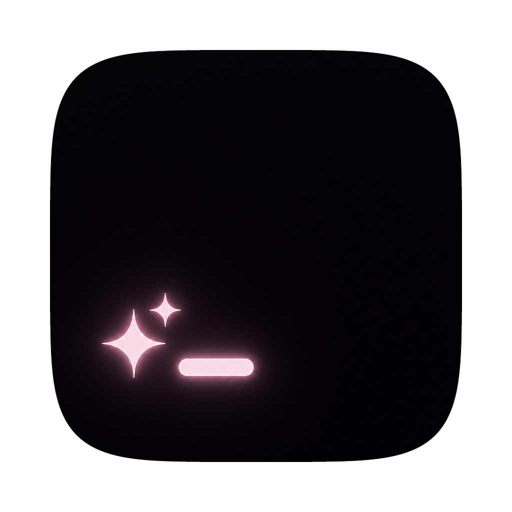

<p align="center">
  
</p>

<h1 align="center">✦ Terminail ✦</h1>

<p align="center">
  A teeny-tiny, kawaii terminal that pops out with one hotkey ₍ᐢ. .ᐢ₎♡<br>
  No dependencies · pure Swift · the whole app is about 2MB.
</p>

<p align="center">
  <a href="#-requirements"></a>
  <a href="#-requirements"></a>
  <a href="https://www.swift.org"></a>
  <a href="#-development"></a>
  <a href="https://github.com/lay-kuw/Terminail/releases"></a>
  <a href="LICENSE"></a>
</p>

<p align="center">｡･:*:･ﾟ★ sparkles included, enjoy! ★ﾟ･:*:･｡</p>

<p align="center">
  
</p>

---

## 🌸 Contents

- [Features](#-features)
- [Requirements](#-requirements)
- [Install](#-install)
- [How to use](#-how-to-use)
- [Feature details](#-feature-details)
- [Configuration](#-configuration)
- [What works](#-what-works)
- [Development](#-development)
- [License](#-license)

## ✨ Features

- **🪟 Frosted glass**: set the opacity, blur, and corner roundness however you like. Comes with TokyoNight and 5 more themes
- **⌨️ Summon with a hotkey**: `⌥ Space` shows or hides every window at once, with a fade / particle / glitch entrance
- **✦ Tabs**: each tab gets an icon (✦ ☾ ♪ ♡ ...) and its own color. With 2+ tabs, the window edge glows in the tab's color
- **💖 Playful bits**: sparkles when you type, press Enter, or delete. The cursor glides, the screen wiggles on a bell, and the cursor "breathes" when you're idle
- **🌠 Gliding-light scrollbar**: a little light slides along the right edge to show where you are. You can grab it and drag, too
- **🔔 Long-command alerts**: when a command finishes in a tab you aren't looking at, a toast, the Dock, and the tab icon let you know
- **🔍 Search & 📝 logging**: search through everything, including scrollback. Record a tab to a text file
- **🔒 Security**: Secure Keyboard Entry, and pasted text can't sneakily run commands
- **🇯🇵 Japanese input**: full IME support, with Menlo + Hiragino as the default fonts
- **⚡ Light**: almost nothing runs while idle. Only the lines that changed are redrawn

## 🍓 Requirements

- macOS 13 or later
- An Apple Silicon Mac
- Xcode or the Command Line Tools (`xcode-select --install`)

## 🎀 Install

```sh
git clone https://github.com/lay-kuw/Terminail.git
cd Terminail
bash build.sh install
```

This builds the app, puts it in `~/Applications/Terminail.app`, and launches it. Yay ٩(ˊᗜˋ*)و
To start it at login, add it in System Settings → General → Login Items.

> **Note**
> The bundle identifier is `io.github.lay-kuw.terminail`, and the config folder is `~/.config/terminail`.

## 🐾 How to use

| Action | Key |
|---|---|
| Show / hide all windows | `⌥ Space` (configurable) |
| New window | `⌘N` |
| New tab | `⌘T` |
| Next / previous tab | `⌘]` / `⌘[` (or click the tab bar) |
| Close a tab | `exit` (closes the window if it's the last tab) |
| Close a window | `⌘W` or the red button |
| Copy / paste | `⌘C` / `⌘V` (drag to select, double-click for a word) |
| Search | `⌘F` to open / close |
| Stop a paste midway | `Ctrl+C` (drops the part of a big paste that hasn't been sent yet) |
| Font size | `⌘+` / `⌘-`, `⌘0` to reset |
| Clear screen and scrollback | `⌘K` |
| Start / stop a log | Edit → New Log… / Stop Log |
| Open the config file | `⌘,` |
| Quit | `⌘Q`, or close the last window |

- All windows are equal. The hotkey shows and hides them together, and hiding takes you back to the app you were using
- Closing the last window (red button, `⌘W`, or `exit` in the last tab) also quits the app
- The Window menu lists open windows as Terminail 1, 2, … (the current one gets a ✦)
- Opening the app again doesn't start a second copy. The running one just pops its window out

## 🍰 Feature details

<details>
<summary><b>✦ Tabs</b></summary>

- A tab is named after the shell's current folder (`~` for home). While a command runs, it shows the command's name instead
- The tab bar hides when there's only one tab (`tab-bar = always` keeps it visible)
- `tab-style = pill` (default): round tabs with an icon and a name, to the right of the traffic lights
- `tab-style = dots`: icons lined up in the middle of the traffic-light row, with the current tab's name below
- Icons go ✦ ☾ ♪ ♡ ... in the order tabs are opened (`tab-icons = symbol`). You can also pick `none` or `custom` (`tab-icon-list = ★, ☆, ♠`)
- When you're back to one tab, it resets to the starting look (✦, white)

</details>

<details>
<summary><b>🎨 Tab colors</b></summary>

The colors are ✦ white, ☾ purple, ♪ cyan, ♡ red, ... (taken from the theme).

| `tab-colors` | Effect |
|---|---|
| `edge` (default) | Same as `cursor`, plus the whole window edge softly glows when there are 2+ tabs |
| `cursor` | The icon, cursor, and sparkles take the tab's color |
| `icon` | Only the icon |
| `off` | The usual colors |

</details>

<details>
<summary><b>🌠 Scrolling</b></summary>

- While you scroll, a little light glides along the rail on the right edge to show your position (scroll fast and it leaves a trail). It fades about a second after you stop
- Move the mouse to the right edge and the rail appears. Grab the light to drag it, or click the rail to jump
- While you're scrolled back, a glowing ball sits at the bottom right. Press it to return to the newest line
- `scrollback-limit` sets how many lines are kept (default 5000)
- `smooth-scroll = true` (default): scrolling is smooth instead of jumping line by line. The trackpad follows your fingers exactly, and a mouse wheel eases along behind. Set `false` for line-by-line scrolling

</details>

<details>
<summary><b>🔔 Long-command alerts</b></summary>

When a command that took `notify-after` seconds or more (default 10) finishes, Terminail tells you. It stays quiet for the tab you're currently looking at.

| Value in `notify` | How you're told |
|---|---|
| `toast` | A small round notice at the top right of the screen. Click it to jump to that tab |
| `dock` | The Dock icon bounces and a badge shows how many finished |
| `tab` | That tab's icon keeps glowing (until you look at it) |
| `system` | A macOS notification (asks for permission the first time) |

The default is `toast, dock, tab`. Things you keep open, like vim or ssh, are in `notify-ignore` and never trigger an alert.
No shell setup needed. (Terminail checks the foreground process once a second.)

</details>

<details>
<summary><b>🔍 Search</b></summary>

- `⌘F` opens a search box at the top right. It searches scrollback too (not case-sensitive)
- `⏎` / ▲ for older matches, `⇧⏎` / ▼ for newer ones, and `Esc` / × / `⌘F` again to close

</details>

<details>
<summary><b>📝 Logging</b></summary>

- Edit → New Log… lets you pick a file. Everything in the tab so far is written out, and new output keeps being added
- A small red dot at the top right of the window shows that it's recording. It stops on Stop Log or when the tab closes
- Saved as plain text with colors and styling stripped (things wiped by `clear` are kept, too)
- Log files are created so only you can read and write them (mode 600)
- Lines are appended once they scroll off the screen. The last few lines still on screen are written when you Stop Log
- If writing fails (a full disk, for example), recording stops and you get a notice

</details>

<details>
<summary><b>🔒 Security</b></summary>

- **Secure Keyboard Entry** (on by default): while Terminail is in front, other apps can't peek at your keystrokes. Turn it off with `secure-keyboard-entry = false`
- The "end of paste" marker is stripped from pasted text, so a paste can't run commands on its own
- Escape sequences that try to change the window title or the clipboard are ignored
- `⌘K` wipes the screen and scrollback together (handy when you've shown a secret by accident). It always clears the screen on the app side, even while a command is running
- Log files are created so only you can read and write them
- The app is signed with the Hardened Runtime, which keeps other programs from injecting code
- While a password prompt is active (like `sudo` or `ssh`, when typed characters aren't shown), input skips the IME and is sent as-is, so your password never ends up in the IME's learning data

</details>

## 🧁 Configuration

`~/.config/terminail/config.conf` is created the first time you launch the app. Save it and changes apply right away.
Unusable values (`nan`, `inf`, numbers out of range) are ignored and the default is used instead (out-of-range numbers are clamped to the limit).
The format is `key = value`, and lines starting with `#` are comments.

<details open>
<summary><b>Default config file</b></summary>

```conf
# ✦ Terminail config
# Changes apply as soon as you save. See the README for more options.
# (Lines starting with # are comments.)

# Starting size (in cells)
window-columns = 120
window-rows = 25

# Background opacity: 0.0 (clear) to 1.0 (solid)
background-opacity = 0.80
# Background blur: 0 (none) to 100
background-blur = 0
# Corner roundness
corner-radius = 8
# Keep the window above everything else
always-on-top = false

# The second font-family is used for characters the first one lacks (like Japanese)
font-family = Menlo
font-family = Hiragino Sans W4
font-size = 13
line-height = 1.0

# tokyonight / catppuccin / dracula / nord / gruvbox / onedark
theme = tokyonight
# To change just a few colors, list only those (examples)
# background = #1A1B26
# foreground = #C0CAF5
# palette = 1=#F7768E

# The key that shows / hides the windows (e.g. ctrl+` / cmd+shift+t / f12)
hotkey = option+space

# Entrance animation: fade (0.2s) / particle (0.4s) / glitch (0.4s) / random
summon-animation = glitch
summon-random = fade, particle, glitch
# Animation speed (0.5 = twice as fast, 2.0 = slow)
summon-speed = 1.0

# Cursor shape: block / bar / underline
cursor-style = block

# Wiggle the screen on a bell
bell-shake = true
# Sparkles while typing
cursor-sparkles = true
# Sparkles on Enter (how many: enter-sparkle-count)
enter-sparkles = true
enter-sparkle-count = 4
# The cursor glides with a little trail when it moves
cursor-glide = true
# Scroll smoothly instead of line by line
smooth-scroll = true
# Sparkles get sucked in when you delete (how many: delete-sparkle-count)
delete-sparkles = true
delete-sparkle-count = 2

# Tabs (⌘T to open, exit to close)
# Look: dots (a row of icons) / pill (round tabs with names)
tab-style = pill
# Icons: symbol (✦ ☾ ♪ ♡ ...) / none / custom (list them in tab-icon-list)
tab-icons = symbol
# tab-icon-list = ★, ☆, ♠
# Tab bar: auto (hidden when there's only one tab) / always
tab-bar = auto
# Tab colors: cursor (cursor and sparkles too) / icon (icon only) / edge (cursor + glowing window edge) / off
tab-colors = edge

# Tell you when a long command finishes (only for tabs and windows you aren't looking at)
# toast (small, top right) / system (macOS notification) / dock (Dock bounce) / tab (glowing tab icon) / off
# Combine as many as you like (e.g. notify = toast, tab)
notify = toast, dock, tab
# How many seconds counts as "long"
notify-after = 10

# The cursor gently breathes when you leave it alone: breathe / off
idle-effect = breathe
# Seconds of idle time before it starts
idle-after = 1

# Keep other apps from peeking at your keystrokes
secure-keyboard-entry = true
```

</details>

<details>
<summary><b>Change just a few colors</b></summary>

Add only the colors you want to change on top of a theme. The 16 palette colors use `palette = number=color`.

```conf
theme = tokyonight
background = #16161E
foreground = #C0CAF5
cursor-color = #C0CAF5
selection-background = #33467C
palette = 1=#FF7A93
palette = 12=#9AB8FF
```

</details>

<details>
<summary><b>Options that aren't in the file but still work</b></summary>

| Option | Default | What it does |
|---|---|---|
| `window-padding` | `4` | Inner padding (all four sides) |
| `window-padding-x` / `window-padding-y` | same as `window-padding` | Left-right only / top-bottom only |
| `window-padding-top` etc. | same as `window-padding` | One side at a time (the top gets 28px extra for the traffic lights) |
| `window-padding-balance` | `true` | Spread leftover space evenly |
| `window-width` / `window-height` | `860` / `520` | Size in px when `window-columns` / `window-rows` are 0 |
| `window-theme` | `dark` | `light` / `auto` |
| `background-opacity-cells` | `true` | Apply opacity to cells with a background color, too |
| `background-blur-mode` | `layer` | `window` uses the WindowServer blur |
| `font-thicken` | `false` | Thicken text with macOS font smoothing |
| `bold-is-bright` | `false` | Draw bold text in bright colors |
| `cursor-sparkle-count` | `2` | Number of sparkles while typing |
| `bell-sound` | `false` | Actually play the beep |
| `tab-icon-list` | none | Icons for `tab-icons = custom` (e.g. `★, ☆, ♠`) |
| `notify-ignore` | `vim, nvim, vi, nano, emacs, less, more, man, top, htop, btop, ssh, mosh, tmux, screen` | Commands that never trigger an alert |
| `command` | `$SHELL` | The shell to run |
| `scrollback-limit` | `5000` | Lines of scrollback to keep |
| `macos-option-as-alt` | `false` | Use ⌥ as the Meta key |

</details>

## 🌈 What works

- ✅ 256 colors and TrueColor, bold / italic / underline, full-width characters, Japanese input
- 🔺 Emoji (single emoji show up fine, but combined ones like 👩‍💻 and skin-tone variants break)
- ✅ Scrollback, the alternate screen (vim / less / htop and friends), bracketed paste
- ✅ Tabs, multiple windows, search, logging
- ✅ Text rewraps when you change the window width or font size (nothing disappears when you make it narrow). While dragging, text stays pinned to the top left, and the padding tidies up when you let go
- ✅ Long lines wrapped by the window width stay as one line when copied or logged
- 💭 Not yet: split panes, mouse reporting, ligatures, inline images (I might add them someday, if I feel like it~)

## 🧸 Development

```sh
bash dev.sh
```

Every time you edit something in `Sources/`, it rebuilds and relaunches by itself (`Ctrl+C` to stop).

```
.
├── Sources/
│   ├── main.swift          The app itself (menus, hotkey, show/hide, alerts, frosted glass)
│   ├── TermWindow.swift    One window (tabs, tab bar, search box, glowing edge)
│   ├── TerminalView.swift  Drawing, key input, IME, selection, scrolling, search, logging
│   ├── Terminal.swift      Escape-sequence parsing and screen state
│   ├── PTY.swift           Starting the shell and talking to it
│   ├── Effects.swift       Entrance animations, sparkles, the wiggle
│   ├── ScrollGlow.swift    Gliding-light scrollbar, back-to-newest button
│   ├── Toast.swift         The "long command finished" toast
│   ├── Config.swift        Config file (conf format)
│   └── Themes.swift        Color themes
├── Resources/AppIcon.png   App icon (1024×1024)
├── Info.plist
├── build.sh                Build / install
├── dev.sh                  Watch for changes and rebuild
└── LICENSE                 MIT License
```

## 💌 License

[MIT License](LICENSE). Anyone can use it freely (modify it, share it, even use it commercially). Enjoy ❤️

